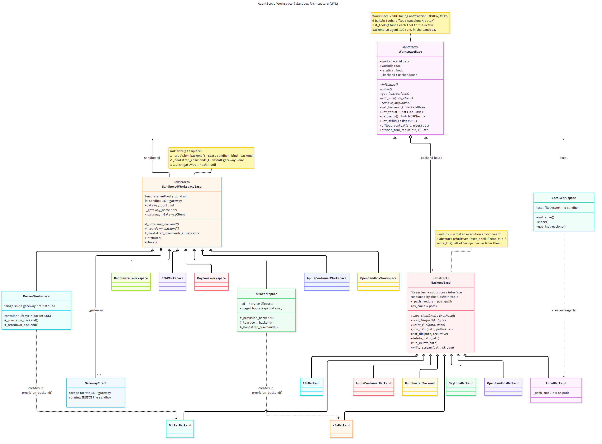
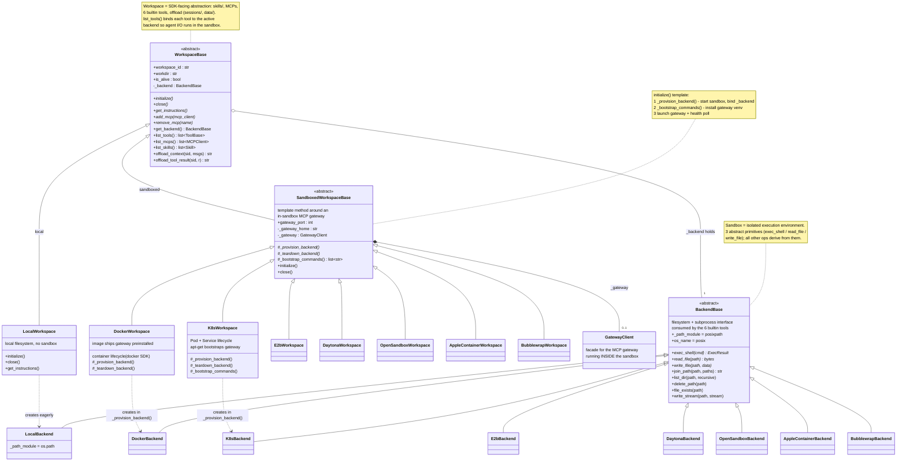

# AgentScope 框架解析

对 [AgentScope](https://github.com/agentscope-ai/agentscope) 框架的源码架构解析：UML 类图 + 说明。基于 `agentscope 2.0.10` 源码整理。

## 图目录

| 主题 | 源码 | PNG | SVG |
|---|---|---|---|
| 工作区与沙箱体系（Workspace & Sandbox） | [workspace-sandbox-uml.mmd](workspace-sandbox-uml.mmd) | [PNG](workspace-sandbox-uml.png) | [SVG](workspace-sandbox-uml.svg) |

## 工作区（Workspace）与沙箱（Sandbox）体系

### 概念关系

在 `agentscope.workspace` 模块中，**工作区是上层概念，沙箱是执行底座**，二者是组合关系而非继承关系：

- **工作区**（`WorkspaceBase`）是面向 SDK/Agent 的抽象接口，提供三类能力：
  - **资源**：技能（skills），按 agent 分区存放在 `skills/` 下；
  - **工具**：MCP 服务器管理（`.mcp` 声明文件）+ 内置六件套（`Bash`/`Edit`/`Glob`/`Grep`/`Read`/`Write`）；
  - **卸载**：上下文与工具结果的持久化（`sessions/`、`data/` 目录）。
- **沙箱**是这些文件操作和命令实际运行的隔离环境（Docker 容器、K8s Pod、E2B 云沙箱等）。工作区持有 `_backend`（一个 `BackendBase` 实例），所有 I/O 都委托给它；`list_tools()` 会把每个内置工具绑定到当前 backend，因此 Agent 的工具执行全部落在沙箱内。

因此**一个沙箱实现 = 一个 Workspace 子类（管生命周期）+ 一个 Backend 子类（管实际 I/O）成对出现**（如 `DockerWorkspace` + `DockerBackend`）。

### 涉及的三个基类

| 基类 | 源码位置 | 职责 |
|---|---|---|
| `WorkspaceBase` | `src/agentscope/workspace/_base.py` | 所有工作区的抽象接口：`initialize`/`close` 生命周期、`list_tools`/`list_mcps`/`list_skills`、`offload_*`、`add_mcp`/`remove_mcp`，以及从 `workdir` 推导的标准目录布局 |
| `SandboxedWorkspaceBase` | `src/agentscope/workspace/_sandboxed_base.py` | 沙箱化工作区的模板方法基类：围绕**沙箱内 MCP 网关**实现生命周期，子类只需实现 `_provision_backend`（创建/接入沙箱并绑定 backend）、`_teardown_backend`（销毁沙箱）、`_bootstrap_commands`（安装网关） |
| `BackendBase` | `src/agentscope/tool/_builtin/_backend.py` | 文件系统 + 子进程接口（位于 `agentscope.tool`，因为内置工具消费它）：只需实现 `exec_shell`、`read_file`、`write_file` 三个抽象原语，其余文件操作都基于这三个原语派生 |

### UML 类图



### 继承关系速览

```text
【工作区线】agentscope.workspace          【执行后端线】agentscope.tool
WorkspaceBase (抽象)                      BackendBase (抽象)
├── LocalWorkspace                        ├── LocalBackend
└── SandboxedWorkspaceBase (抽象)          ├── DockerBackend
    ├── DockerWorkspace                   ├── K8sBackend
    ├── K8sWorkspace                      ├── E2BBackend
    ├── E2BWorkspace                      ├── DaytonaBackend
    ├── DaytonaWorkspace                  ├── OpenSandboxBackend
    ├── OpenSandboxWorkspace              ├── AppleContainerBackend
    ├── AppleContainerWorkspace           └── BubblewrapBackend
    └── BubblewrapWorkspace
```

`DockerWorkspace.initialize()` 的完整链路：

1. `SandboxedWorkspaceBase.initialize()`（模板方法）调用子类 `_provision_backend()`；
2. `DockerWorkspace._provision_backend()` 启动/接入容器，绑定 `self._backend = DockerBackend(container, workdir)`；
3. 执行 `_bootstrap_commands()` 在沙箱内安装并启动 MCP 网关（Docker 镜像已预装故跳过；K8s 走 `apt-get` 安装）；
4. 网关健康轮询通过后，工作区就绪。

`LocalWorkspace` 直接继承 `WorkspaceBase` 而不经过 `SandboxedWorkspaceBase`，因为它没有沙箱，也就没有沙箱内网关和供应/销毁环节。

### Mermaid 源码

GitHub 原生渲染（与 `workspace-sandbox-uml.mmd` 内容一致）：



### 本地重新渲染

```bash
npm install @mermaid-js/mermaid-cli
mmdc -i workspace-sandbox-uml.mmd -o workspace-sandbox-uml.png -b white --scale 4
mmdc -i workspace-sandbox-uml.mmd -o workspace-sandbox-uml.svg -b white
```

> Windows 上若提示找不到 Chrome，可加 `-p puppeteer.json`，内容为
> `{"executablePath": "C:\\Program Files\\Google\\Chrome\\Application\\chrome.exe", "args": ["--no-sandbox"]}`。

## 分析版本

- AgentScope `2.0.10`（2026-10 整理）
